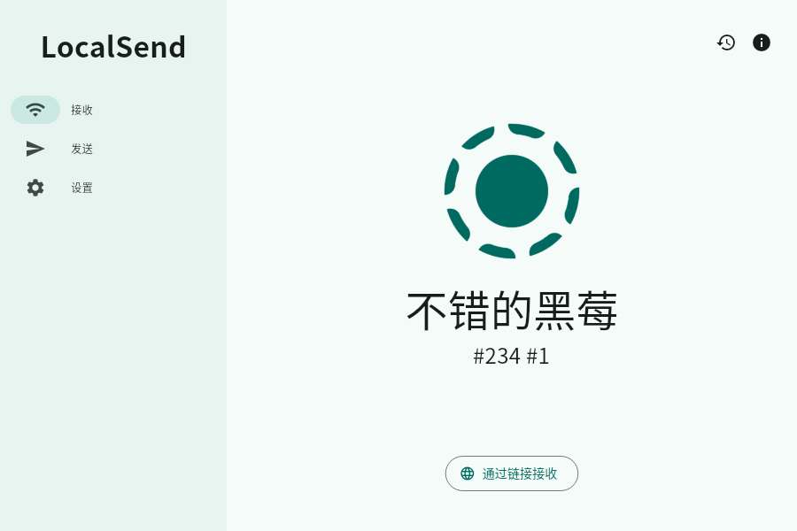

# LocalSend arm64 · glibc 2.31 兼容重建版

[LocalSend](https://localsend.org/) 官方 arm64 安装包在银河麒麟 V10、UOS 20 这类国产 arm64 系统上装不上。这个仓库提供一份**从同版本源码重新编译**的 deb，能在 glibc 2.31 的系统上直接运行。

版本对应上游 LocalSend **1.19.0**（build 65），除构建环境外未修改任何功能代码。

---

## 为什么需要重建

官方 releases 里的 `LocalSend-1.19.0-linux-arm-64.deb` 声明：

```
Pre-Depends: libc6 (>= 2.34)
```

因为官方 CI 跑在 `ubuntu-22.04-arm` 上。而麒麟 V10 SP1 的 glibc 是 `2.31-0kylin9.1k22.5`，装上之后一启动就报：

```
./localsend_app: /lib/aarch64-linux-gnu/libc.so.6: version `GLIBC_2.34' not found
./localsend_app: /lib/aarch64-linux-gnu/libc.so.6: version `GLIBC_2.33' not found
```

这不是代码用了新 API，而是**编译机的 glibc 版本被写进了 ELF 的符号版本表**。同一份源码在 glibc 2.31 的机器上编译，产物最高只需要 GLIBC 2.30，问题自然消失。

## 安装

从 [Releases](../../releases) 或本仓库 `dist/` 下载 deb，然后：

```bash
sudo apt install ./localsend_1.19.0+65-1kylin1_arm64.deb
```

用 `apt` 而不是 `dpkg -i`，好处是依赖缺了会自动补。

装好后：

- 应用菜单里搜 **LocalSend**
- 或命令行执行 `localsend_app`



## 卸载

```bash
sudo apt remove localsend
```

## 适用系统

- 架构：**arm64 / aarch64**（x86_64 请直接用官方包）
- glibc：**>= 2.31**（向上兼容，更新的发行版也能装）
- 已在 **银河麒麟 V10 SP1**（glibc 2.31-0kylin9.1k22.5，飞腾 CPU）实机验证

## 兼容性实测数据

本包各二进制实际要求的最高符号版本：

| 文件 | 需要的最高 GLIBC | 说明 |
|---|---|---|
| `localsend_app` | 2.17 | C++ runner |
| `lib/*plugin.so`（12 个 Flutter 插件） | 2.17 | tray、window_manager 等 |
| `lib/libflutter_linux_gtk.so` | 2.18 | Flutter 引擎本体 |
| `lib/librust_lib_localsend_app.so` | 2.30 | Rust 核心（LocalSend 协议实现） |

对照组：官方包同一批文件里，`localsend_app` 和 Rust 库都是 **2.34**。多出来的只有 `__libc_start_main@GLIBC_2.34`、`stat@GLIBC_2.33`、`fstat@GLIBC_2.33` 三个符号，全部来自编译机的 crt 和 glibc 头文件。

构建环境：

| 项目 | 版本 |
|---|---|
| Flutter | 3.41.9（Dart 3.11.5，从 GitHub 源码自举的 arm64 工具链） |
| Rust | 1.97.1 |
| clang | 10.0.0 |
| 目标 | aarch64-unknown-linux-gnu，glibc 2.31 |

## 包信息

```
Package:      localsend
Version:      1.19.0+65-1kylin1
Architecture: arm64
Installed-Size: 89352 KB
Depends:      libgtk-3-0, libayatana-appindicator3-1, libayatana-ido3-0.4-0,
              libdbusmenu-glib4, libegl1, libgles2, libstdc++6, xdg-user-dirs
```

安装位置与官方包一致（`/opt/localsend_app`，桌面文件、图标、`/usr/bin/localsend_app` 符号链接都相同）。包名同为 `localsend`、版本号更高（`1.19.0+65-1kylin1` > `1.19.0+65`），所以如果之前装过官方包，本包会直接顶替它，不用先卸载。

## 已知限制

**1. 图形渲染可能走软件模式。**
飞腾等国产 GPU 的 Mesa 驱动给不出 Flutter 要求的 GL 上下文（实测报 `doesn't support any form of non-power-of-two textures`、顶点着色器编译失败），Flutter 会自动回落到软件渲染。功能完全正常，只是界面由 CPU 绘制，传文件这种场景感知不到差别。想强制试硬件加速：

```bash
FLUTTER_LINUX_RENDERER=opengl localsend_app
```

**2. 只有 arm64。** x86_64 机器请用官方包，官方 x64 包要求 glibc 2.34 但主流发行版都满足。

**3. 不会自动更新。** 上游发新版本后需要重新构建，见下节。

**4. 首次启动较慢。** 软件渲染下首帧需要几秒，属正常现象。

## 从源码重新构建

```bash
git clone <本仓库>
cd localsend-arm64-glibc231
./build-all.sh
```

脚本会依次：检查系统依赖 → 拉取上游源码 → 固定 FRB 版本 → 自举 arm64 Flutter → 检查 Rust → 构建 → 打 deb。

系统依赖（需要 root）：

```bash
sudo apt-get install -y clang cmake ninja-build pkg-config \
    libgtk-3-dev libayatana-appindicator3-dev
```

### 构建过程中踩到的两个坑

**坑一：官方的 Flutter 没有 arm64 Linux 预编译包。**
`releases_linux_arm64.json` 是 404，`flutter_linux_3.41.9-stable.tar.xz` 里也是 x64 的 Dart。但官方 CI 用 `git clone --branch 3.41.9` 绕过了这个问题——从 git 检出时 Flutter 会按本机架构下载 arm64 Dart SDK 并现场自举。所以 clone 源码即可，不需要什么特殊手段。

**坑二：`ld.lld` 缺失。**
Flutter 3.41 的 native assets 步骤会在 clang 所在目录找 `ld.lld`，麒麟的 `clang-10` 包里没有。`build-all.sh` 的做法是在 `~/.local/llvm-shim/` 放一份 clang **副本**，把 `ld` 软链成 `ld.lld` 代替。注意必须是副本：Flutter 会对 clang 路径做 realpath 解析，软链会被解析回 `/usr/lib/llvm-10/bin`，等于没换。

另外，`packages/localsend_isolates/pubspec.yaml` 里的 `flutter_rust_bridge: ^2.12.0` 必须固定成 `2.12.0`。仓库里的 Rust crate 和已生成的 Dart 绑定都是 2.12.0，用 `^` 允许升到 2.13.0 后，启动时会直接拒绝初始化：

```
codegen version (2.12.0) should be the same as runtime version (2.13.0)
```

## 相对上游改了什么

只有一行，且与功能无关：

```diff
# packages/localsend_isolates/pubspec.yaml
-  flutter_rust_bridge: ^2.12.0
+  flutter_rust_bridge: 2.12.0
```

打包脚本 `build-deb.sh` 是本仓库新增的，不涉及上游代码。

## 许可证

LocalSend 采用 [Apache License 2.0](LICENSE)。本仓库是对其未修改源码的重新编译分发，同样遵循 Apache-2.0，并在此说明修改内容（仅上述一行依赖版本固定）。上游版权归 LocalSend 作者 Tienisto 及贡献者所有。

本项目与 LocalSend 官方无关联，问题请提到本仓库，不要打扰上游。
